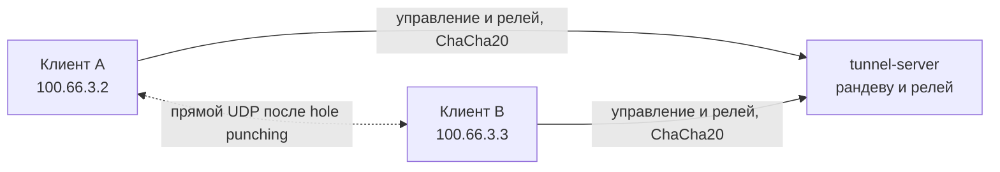

# VoidLink

**Виртуальная локальная сеть для своих: соберите группу из друзей и играйте так, будто все сидят в одной LAN.**

[](https://github.com/adamantida/VoidLink2/actions/workflows/ci.yml)


VoidLink работает по схеме Hamachi и ZeroTier: участники объединяются в группы,
каждый получает постоянный IP вида `100.66.<gid>.x`, и внутри группы проходят
`ping`, игровой трафик и любые TCP/UDP-сервисы. Сервер свой, ключи свои.

**Содержание:** [Что это](#что-это) · [Возможности](#возможности) · [Интерфейс](#интерфейс) · [Быстрый старт](#быстрый-старт) · [Команды](#команды) · [Структура](#структура-проекта) · [Документация](#документация) · [Статус](#статус-и-дорожная-карта) · [Участие](#участие-в-разработке)

---

## Что это

Сервер VoidLink — точка встречи: хранит группы, выдаёт IP, принимает приглашения
и помогает клиентам найти друг друга. Пока прямого канала нет, трафик идёт через
сервер как через релей. Когда клиенты пробили NAT (UDP hole punching), пакеты
идут напрямую, peer-to-peer.



Полезная нагрузка группы шифруется ключом группы, который выдаёт сервер. Релей
видит только открытый заголовок `gid | src_ip | dst_ip`. Список друзей хранится
у клиента, а не на сервере. IP закреплён за ключом участника и возвращается с ним
после офлайна.

---

## Возможности

### Сеть

- Публичные и приватные группы, адреса `100.66.<gid>.0/24` (gid от 1 до 254).
- Прямой канал через UDP hole punching, релей сервера работает сразу как запасной путь.
- Автовход в выбранные группы при запуске, поиск LAN-адресов, переподключение
  за секунды после перезапуска сервера.
- Приглашения не теряются, даже если адресат был офлайн. Режим невидимки.
- Резервный TCP-путь на случай блокировки UDP (встраивается в движок клиента).

### Безопасность

- Identity на ed25519 (подписи) и x25519 (ключи канала). Friend code выглядит как `TUN-XXXX…`.
- Сквозное шифрование ChaCha20-Poly1305. HELLO подписан, клиент закрепляет ключ сервера (pinning).
- Cookie и CHALLENGE на рукопожатие, окно повторов для шифрованных фреймов.
- Лимиты скорости на сессию, IP, группу и сервер. Ротация ключа: `tunnel-server rotate-key`.

Подробнее: [SECURITY](docs/SECURITY.md).

### Интерфейс

- **CLI** `tunnel-client` для скриптов и быстрых действий.
- **TUI** на ratatui: группы, друзья, участники, лог, приглашения, мышь, поиск,
  командная строка `:`, пять тем (тёмная, светлая, контрастная, янтарная, фьорд).
- **Служба Windows** `tunnel-daemon`: туннель поднимается до входа пользователя.
  TUI и CLI подключаются к ней по именованному каналу без прав администратора.
- **Трей** `tunnel-tray`: состояние соединения и уведомления.

### Платформы

| Компонент | Windows | Linux | macOS |
|---|:---:|:---:|:---:|
| Сервер `tunnel-server` | отладка | да | отладка |
| Клиент: CLI и TUI | да | да | да |
| Туннель (TUN-адаптер) | да (Wintun) | в доработке | в доработке |
| Служба и трей | да | — | — |

---

## Интерфейс

TUI работает в терминале. Слева группы и друзья, справа участники выбранной
группы, внизу лог и график трафика:

```text
┌ VoidLink ── сервер 203.0.113.10:5555 ── подключено ────────────────────────┐
├ Группы ──────────────┬ Участники «mynet» · 100.66.3.x ─────────────────────┤
│ ▸ mynet     [pub]  4 │ IP           связь    RTT   имя                     │
│   home      [prv]  2 │ 100.66.3.2   direct   12ms  alpha                   │
│ Друзья               │ 100.66.3.3   relay    48ms  bravo                   │
│ ● bravo              │ 100.66.3.4   —        —     charlie   (офлайн)      │
├ Лог ──────────────────────────────────────────────── Трафик ↓ 1.2 МБ/с ──┤
│ 12:05 alpha: прямой канал установлен                                       │
└ : команда · / поиск · Tab фокус · F1 справка ───────────────────────────────┘
```

Клавиши, мышь и темы: [TUI](docs/TUI.md).

---

## Быстрый старт

### Сервер на Linux

Нужен VPS с белым IP и открытым UDP-портом (по умолчанию `5555`).

```bash
cargo build --release -p tunnel-server
sudo infrastructure/linux/install-server.sh target/release/tunnel-server --listen 0.0.0.0:5555
sudo ufw allow 5555/udp
```

Установщик создаёт службу `tunnel-server` и печатает **Server code** (`TUN-…`):
клиенты вписывают его при добавлении сервера. Подробнее: [SERVER](docs/SERVER.md).

### Клиент на Windows

1. Распакуйте архив и в PowerShell от администратора выполните:

   ```powershell
   powershell -ExecutionPolicy Bypass -File .\install.ps1
   ```

2. Добавьте сервер из `%ProgramFiles%\Tunnel`:

   ```powershell
   .\tunnel-client.exe add-server 203.0.113.10:5555 TUN-XXXX… mysrv
   ```

3. Задайте имя и откройте интерфейс:

   ```powershell
   .\tunnel-client.exe set-name alpha
   .\tunnel-client.exe tui
   ```

В TUI создайте группу (`F2`) или войдите в существующую (`j`). Подробнее: [INSTALL](docs/INSTALL.md).

### Клиент на Linux и macOS

Сборка, CLI и TUI работают. TUN-адаптер для этих систем в доработке.

```bash
cargo build --release -p tunnel-client
./target/release/tunnel-client add-server 203.0.113.10:5555 TUN-XXXX… mysrv
./target/release/tunnel-client create mynet --private
./target/release/tunnel-client tui
```

Когда оба участника в группе, проверка связи: `ping 100.66.<gid>.3`.

---

## Команды

### Клиент `tunnel-client`

| Команда | Действие |
|---|---|
| `id` | friend code и ключи identity |
| `set-name <имя>` / `set-status <текст>` | имя и статус |
| `add-server <addr> <code> [label]` / `servers` / `del-server <N\|addr\|label>` | серверы клиента |
| `groups` | группы на сервере |
| `create <имя> [--private]` | создать группу (владелец — вы) |
| `join <gid>` / `leave <gid>` / `delete <gid>` | войти, выйти, удалить |
| `invite` / `kick` / `ban` / `unban <gid> <peer>` | приглашения и модерация (владелец) |
| `invites` / `decline <gid>` | неотвеченные приглашения и отказ |
| `add-friend <code> [alias]` / `del-friend <alias>` / `friends` | друзья (хранятся локально) |
| `run` | поднять туннель, лог в консоль |
| `tui` (`ui`) | интерфейс |

`peer` — friend code (`TUN-…`), hex-ключ или alias. Полный список и остальные
команды: `tunnel-client` без аргументов и [CLIENT](docs/CLIENT.md). Глобальные
флаги: `--dir`, `--debug`, `--server`, для `run` ещё `--adapter` и `--dll`.

### Служба и сервер

- `tunnel-daemon console|service|install|uninstall [--purge]`: консоль, режим SCM, установка и удаление службы. См. [DAEMON](docs/DAEMON.md).
- `tunnel-server [адрес=0.0.0.0:5555] [--data <dir>] [--workers N] [-q]`, а также лимиты `--relay-rate`, `--join-rate`, `--max-owned-groups` и другие. Подкоманда `rotate-key`. См. [SERVER](docs/SERVER.md).

---

## Структура проекта

Cargo-workspace на Rust 2024:

| Каталог | Назначение |
|---|---|
| `crates/protocol` | протокол v3: фреймы, рукопожатие, identity, шифрование, фрагментация |
| `crates/server` | `tunnel-server`: рандеву, группы, IP, приглашения, релей, метрики, персистентность |
| `crates/client` | `tunnel-client`: движок, CLI, TUI, Wintun, DNS, IPv6, TCP-путь |
| `crates/ipc` | протокол и транспорт между службой и интерфейсами |
| `crates/daemon` | `tunnel-daemon`: служба, владеющая туннелем |
| `crates/winsvc` | установка и запуск службы Windows (SCM) |
| `crates/tray` | `tunnel-tray`: значок в трее Windows |

Прочее: `docs/` (документация), `infrastructure/` (systemd, NAT-стенд, скрипты
Windows), `vendor/wintun/` (подписанный `wintun.dll`, который сборка кладёт рядом с exe).

---

## Документация

| Документ | О чём |
|---|---|
| [INSTALL](docs/INSTALL.md) | установка клиента на Windows, Linux и macOS |
| [SERVER](docs/SERVER.md) | сборка, systemd, флаги, ротация ключа |
| [CLIENT](docs/CLIENT.md) | клиент: команды, группы, друзья |
| [TUI](docs/TUI.md) | интерфейс: клавиши, мышь, темы |
| [CONFIG](docs/CONFIG.md) | `client.json`, `server.json` и их поля |
| [TROUBLESHOOTING](docs/TROUBLESHOOTING.md) | типичные проблемы и решения |
| [FAQ](docs/FAQ.md) | частые вопросы |
| [GLOSSARY](docs/GLOSSARY.md) | термины: identity, friend code, gid, lease |
| [ARCHITECTURE](docs/ARCHITECTURE.md) | компоненты, потоки данных, состояние |
| [PROTOCOL](docs/PROTOCOL.md) | спецификация протокола v3 |
| [SECURITY](docs/SECURITY.md) | модель угроз, криптография, ключи |
| [NETWORKING](docs/NETWORKING.md) | NAT, hole punching, релей, TCP-путь, DNS, IPv6 |
| [DAEMON](docs/DAEMON.md) | служба, трей, жизненный цикл туннеля |
| [IPC](docs/IPC.md) | протокол между службой и интерфейсами |
| [DEVELOPMENT](docs/DEVELOPMENT.md) | окружение, сборка, проверки перед коммитом |
| [TESTING](docs/TESTING.md) | тесты, e2e-сценарии, NAT-лаборатория |
| [PLAN](docs/PLAN.md) | план развития по этапам |
| [CHANGELOG](docs/CHANGELOG.md) | история изменений |

---

## Статус и дорожная карта

- **Готово:** протокол v3, группы и lease IP, движок клиента, TUI с мышью и темами,
  многопоточный сервер с лимитами, приглашения, надёжный выход из группы.
- **В доработке:** служба Windows и трей, TUN-адаптер для Linux и macOS, DNS и IPv6
  через туннель, TCP-путь при блокировке UDP, административное окно владельца группы.

Подробно по этапам: [PLAN](docs/PLAN.md).

---

## Участие в разработке

Перед pull request проверьте:

```bash
cargo fmt --all -- --check
cargo test --workspace
cargo clippy --workspace --all-targets -- -D warnings
```

Правила работы с ветками и советы по отладке: [DEVELOPMENT](docs/DEVELOPMENT.md).
Найдя уязвимость, не открывайте публичный issue, а напишите мейнтейнеру напрямую.
