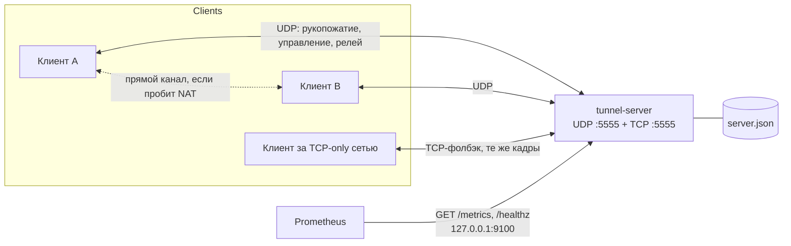

# Сервер VoidLink (`tunnel-server`)

`tunnel-server` — точка встречи и релей виртуальной сети. Он хранит группы,
выдаёт IP-адреса (lease) участникам, ведёт приглашения и баны, отдаёт
адреса для пробития NAT (hole punching) и пересылает трафик между клиентами,
когда прямой канал установить не удалось. Сервер работает на Linux (и на
macOS/Windows — для отладки). Наружу нужен один UDP-порт, по умолчанию `5555`;
при включённом TCP-фолбэке — тот же номер порта по TCP.

Документ рассчитан на администратора VPS: сборка, установка службы, флаги,
метрики, резервные копии, ротация ключа и обновление с v2.

> **Версия.** Описан сервер протокола **v3** ([PROTOCOL.md](PROTOCOL.md)).
> Флаги `--metrics`, `--tcp`, лимиты и `rotate-key` относятся к v3 и
> появляются вместе с ним; сервер v2 их не знает. Сервер v3 несовместим с
> клиентами v2 — см. [раздел об обновлении](#обновление-с-v2).

## Содержание

- [Архитектура и порты](#архитектура-и-порты)
- [Сборка](#сборка)
- [Установка и служба systemd](#установка-и-служба-systemd)
- [Флаги командной строки](#флаги-командной-строки)
- [Метрики и `/healthz`](#метрики-и-healthz)
- [Остановка и перезапуск](#остановка-и-перезапуск)
- [Состояние и резервные копии](#состояние-и-резервные-копии)
- [Ротация ключа сервера](#ротация-ключа-сервера)
- [Ёмкость и нагрузка](#ёмкость-и-нагрузка)
- [Обновление с v2](#обновление-с-v2)
- [Файрвол](#файрвол)
- [Диагностика](#диагностика)

## Архитектура и порты



| что | порт и протокол | кто открывает |
|---|---|---|
| рукопожатие, управление, релей | UDP `5555` (адрес задаётся `TUNNEL_LISTEN` / позиционным аргументом) | клиенты |
| TCP-фолбэк для сетей, где режут UDP | TCP `5555` (тот же номер, флаг `--tcp`) | клиенты |
| метрики и проверка здоровья | TCP, по умолчанию `127.0.0.1:9100` (флаг `--metrics`) | только локально или Prometheus |

Прямой канал между клиентами (без релея) сервер не видит: клиенты пробивают
NAT сами, сервер лишь сообщает им кандидатов адреса.

## Сборка

Сборка на самом сервере или на машине той же архитектуры:

```bash
cargo build --release -p tunnel-server
# результат: target/release/tunnel-server
```

Статический бинарник, не зависящий от версии glibc на VPS (сборка с macOS
или Windows):

```bash
rustup target add x86_64-unknown-linux-musl
cargo install cargo-zigbuild        # или cross
cargo zigbuild --release -p tunnel-server --target x86_64-unknown-linux-musl
# результат: target/x86_64-unknown-linux-musl/release/tunnel-server
```

Для ARM-серверов используйте соответствующий target (например,
`aarch64-unknown-linux-musl`). Проверить, что бинарник запускается, можно
так: `./tunnel-server --help`.

## Установка и служба systemd

Файлы:

| файл | назначение |
|---|---|
| `infrastructure/linux/install-server.sh` | установка и обновление |
| `infrastructure/linux/tunnel-server.service` | юнит systemd |
| `/etc/default/tunnel-server` | адрес и доп. флаги (создаётся при установке) |
| `/var/lib/tunnel/server.json` | состояние сервера |

### Установка одной командой

```bash
sudo infrastructure/linux/install-server.sh [путь/к/tunnel-server] [--listen 0.0.0.0:5555] [--no-start]
```

Без пути скрипт ищет бинарник в `target/release/tunnel-server` (и в
`target/<triple>/release/`) относительно корня репозитория, затем рядом со
скриптом. `--no-start` устанавливает службу, но не запускает её.

Что делает скрипт:

- создаёт системного пользователя `tunnel` (без shell и home);
- копирует бинарник в `/opt/tunnel/tunnel-server` и `docs/SERVER.md` в
  `/opt/tunnel/SERVER.md`;
- ставит юнит в `/etc/systemd/system/tunnel-server.service`;
- создаёт `/etc/default/tunnel-server`, если его ещё нет (существующий файл не
  перезаписывает; `--listen` лишь меняет строку `TUNNEL_LISTEN`);
- включает службу, запускает её и печатает **Server code** (`TUN-…`) — его
  вписывают клиенты командой `add-server <ip:порт> <TUN-код>`;
- повторный запуск — обновление: остановка, замена бинарника, старт.
  `server.json` не трогается.

### Файл настроек

`/etc/default/tunnel-server`:

```text
TUNNEL_LISTEN=0.0.0.0:5555
TUNNEL_ARGS=--workers 4
```

- `TUNNEL_LISTEN` — адрес прослушивания (первый позиционный аргумент сервера);
- `TUNNEL_ARGS` — любые флаги из [таблицы ниже](#флаги-командной-строки).
  Значения разделяются пробелами, кавычки не нужны и не поддерживаются
  юнитом: `TUNNEL_ARGS` подставляется в `ExecStart` как есть.

Изменить настройки:

```bash
sudoedit /etc/default/tunnel-server
sudo systemctl restart tunnel-server
```

### Юнит systemd

Ключевые строки юнита:

```ini
[Service]
User=tunnel
Group=tunnel
EnvironmentFile=-/etc/default/tunnel-server
StateDirectory=tunnel
StateDirectoryMode=0700
WorkingDirectory=/var/lib/tunnel
ExecStart=/opt/tunnel/tunnel-server ${TUNNEL_LISTEN} --data /var/lib/tunnel $TUNNEL_ARGS
Restart=on-failure
RestartSec=2s
KillSignal=SIGTERM
TimeoutStopSec=15s
LimitNOFILE=65536
```

Ужесточение (hardening): `NoNewPrivileges`, `ProtectSystem=strict`,
`ProtectHome`, `PrivateTmp`, `PrivateDevices`, `ProtectKernel*`,
`MemoryDenyWriteExecute`, пустой набор capabilities, `RestrictAddressFamilies`
только `AF_INET`, `AF_INET6`, `AF_UNIX`, фильтр системных вызовов
`@system-service` без `@privileged` и `@resources`. Писать сервер может
только в `/var/lib/tunnel`.

Перезапуск: при падении служба поднимается через 2 с. Если в
`TUNNEL_ARGS` неверный флаг, сервер завершится с ошибкой и служба будет
перезапускаться по кругу — смотрите `journalctl`.

### Полезные команды

```bash
systemctl status tunnel-server
journalctl -u tunnel-server -f                  # события и сводка раз в 5 минут
journalctl -u tunnel-server | grep -m1 TUN-      # Server code
sudo systemctl restart tunnel-server
```

Если сервер запущен с `-q`, Server code в журнале не появится — см.
[флаги](#флаги-командной-строки).

## Флаги командной строки

```text
tunnel-server [адрес=0.0.0.0:5555] [флаги]
tunnel-server rotate-key [--data <dir>]
tunnel-server --help
```

Адрес — первый позиционный аргумент. Любой аргумент, начинающийся с `-`, и
не известный серверу, приводит к ошибке `неизвестный флаг` (сервер не
стартует). Значения флагов проверяются при запуске: ставки и бёрсты —
положительные числа (`rate` > 0, `burst` ≥ 1), `--session-timeout` ≥ 1 с,
`--invite-ttl-days` ≥ 1.

### Основные флаги

| флаг | по умолчанию | описание |
|---|---|---|
| `адрес` (позиционный) | `0.0.0.0:5555` | адрес и порт UDP-прослушивания |
| `--data <dir>` | `tunnel-data` (относительно текущего каталога) | каталог состояния `server.json`; в службе — `/var/lib/tunnel` |
| `--workers N` | `0` (по числу ядер, не больше 8) | число потоков-воркеров на UDP-сокете |
| `-q`, `--quiet` | выключено | не печатать события, сводку раз в 5 минут и строку `Server code: TUN-…` |
| `--metrics <адрес>` | выключено | HTTP-эндпоинт метрик и `/healthz`, например `127.0.0.1:9100` |
| `--tcp` | включено | TCP-фолбэк на том же порту, что и UDP (для сетей, где UDP заблокирован) |
| `-h`, `--help` | — | справка |

Про `-q`: при нём в журнале не будет Server code, а `install-server.sh` его
не покажет. Чтобы узнать код, один раз запустите сервер без `-q`: уберите
флаг из `TUNNEL_ARGS`, `systemctl restart tunnel-server`,
`journalctl -u tunnel-server | grep TUN-`, затем верните флаг.

### Лимиты (раздел 9 [PROTOCOL.md](PROTOCOL.md))

Лимиты защищают сервер от флуда и не дают одному клиенту занять весь релей.
Значения по умолчанию подходят для небольших групп; менять их имеет смысл
только при наблюдаемой нагрузке (см. [метрики](#метрики-и-healthz)).

| флаг | по умолчанию | что ограничивает |
|---|---|---|
| `--relay-rate R` / `--relay-burst B` | `4000` / `8000` | фреймов в секунду на сессию для релея (игровой трафик и RTT-зонды) и запас |
| `--ctrl-rate R` / `--ctrl-burst B` | `50` / `100` | управляющие фреймы в секунду на сессию и запас |
| `--hello-rate R` / `--hello-burst B` | `5` / `20` | HELLO3, а также ответы на них и RESET, в секунду на IP (для IPv6 — на `/64`) |
| `--plain-rate R` / `--plain-burst B` | `2000` / `4000` | открытые ответы без подтверждённого адреса (CHALLENGE, UNSUPPORTED, RESET) на весь сервер |
| `--join-rate R` / `--join-burst B` | `1` / `10` | входы в группу в секунду на группу (не-участники) |
| `--session-timeout <сек>` | `30` | сессия без пакетов столько секунд считается офлайн |
| `--max-owned-groups N` | `16` | сколько групп может владеть одна identity |
| `--invite-ttl-days N` | `7` | срок жизни приглашения, дней |

Пример для сервера с несколькими десятками клиентов и заметным трафиком:

```text
TUNNEL_ARGS=--workers 4 --relay-rate 8000 --relay-burst 16000 --metrics 127.0.0.1:9100
```

### Команда `rotate-key`

Меняет ключ сервера. Подробная процедура — в
[разделе о ротации](#ротация-ключа-сервера).

```bash
sudo systemctl stop tunnel-server
sudo -u tunnel /opt/tunnel/tunnel-server rotate-key --data /var/lib/tunnel
sudo systemctl start tunnel-server
```

Флаг `--data` указывает тот же каталог, что и служба (без него используется
`tunnel-data` в текущем каталоге). Новый ключ вступает в силу после
(пере)запуска сервера.

## Метрики и `/healthz`

### Включение

Метрики отключены, пока не задан `--metrics <адрес>`:

```text
TUNNEL_ARGS=--metrics 127.0.0.1:9100
```

Эндпоинт использует только стандартную библиотеку: один фоновый поток,
ограничены размер заголовков запроса (4 КБ) и время чтения, поэтому
медленные клиенты не держат его долго. Защиты от целенаправленного флуда
это не заменяет — **слушайте только локальный или приватный интерфейс** и
не выставляйте `0.0.0.0:9100` в интернет.

### Пути

| путь | ответ |
|---|---|
| `GET /metrics` | текст в формате Prometheus (версия 0.0.4, с `HELP` и `TYPE`) |
| `GET /healthz` | `200 ok`, если сервер здоров; `503 unavailable` иначе |
| другие пути | `404` |
| не `GET` | `405` |

`/healthz` отвечает `200`, пока работают потоки-воркеры и housekeeping-цикл
(он обслуживает сессии и сохранение состояния) продолжает тикать. Если
`503` не проходит, перезапустите службу и посмотрите журнал.

### Метрики

| имя | тип | смысл |
|---|---|---|
| `voidlink_sessions` | gauge | активные сессии клиентов |
| `voidlink_groups` | gauge | количество групп |
| `voidlink_members` | gauge | участники во всех группах |
| `voidlink_invites_pending` | gauge | неиспользованные приглашения |
| `voidlink_relayed_frames_total` | counter | переданные через релей фреймы |
| `voidlink_dropped_frames_total` | counter | отброшенные фреймы (лимиты, битые, неизвестные) |
| `voidlink_hello_total` | counter | принятые HELLO (включая HELLO3) |
| `voidlink_challenge_total` | counter | отправленные CHALLENGE |
| `voidlink_ctrl_frames_total` | counter | управляющие фреймы |
| `voidlink_bytes_relayed_total` | counter | байты, переданные через релей |

Проверка руками:

```bash
curl -s http://127.0.0.1:9100/metrics | head -20
curl -i http://127.0.0.1:9100/healthz
```

### Scrape в Prometheus

Prometheus на том же сервере (или через SSH-туннель с другой машины):

```yaml
# prometheus.yml
scrape_configs:
  - job_name: voidlink
    scrape_interval: 15s
    static_configs:
      - targets: ['127.0.0.1:9100']
```

Полезные выражения:

```text
# скорость релея, байт/с
rate(voidlink_bytes_relayed_total[5m])

# доля отброшенных фреймов
rate(voidlink_dropped_frames_total[5m]) / rate(voidlink_relayed_frames_total[5m])

# онлайн-сессии
voidlink_sessions
```

Растущий `voidlink_dropped_frames_total` при нормальном трафике — повод
проверить лимиты и не злоупотребляет ли кто-то группой.

## Остановка и перезапуск

`systemctl stop` и `systemctl restart` посылают `SIGTERM`.

Корректное завершение (v3):

1. сервер получает `SIGTERM` (также `SIGINT` и `SIGHUP`; в Windows — Ctrl+C и
   сигналы консоли);
2. перестаёт принимать новые пакеты, воркеры завершаются;
3. выполняется финальное сохранение `server.json` (атомарно: tmp + rename);
4. процесс завершается с кодом `0`.

Повторный сигнал во время завершения принудительно завершает процесс с
кодом `1`. Юнит даёт на остановку 15 с (`TimeoutStopSec=15s`) и только потом
посылает `SIGKILL`.

Клиенты после перезапуска получают `RESET` и переподключаются за несколько
секунд: клиент пингует сервер раз в 5 с, а сессия без пакетов 30 с
(`--session-timeout`) считается офлайн.

Автоперезапуск (`Restart=on-failure`) поднимает упавший сервер через 2 с.

### Если сервер не стартует

- `bad listen addr` или `неизвестный флаг` — опечатка в `TUNNEL_ARGS` или
  `TUNNEL_LISTEN`; исправьте `/etc/default/tunnel-server`;
- `bind ... Address already in use` — порт занят другим процессом; проверьте
  `ss -ulpn | grep 5555`;
- ошибка чтения `server.json` (повреждён) — сервер **намеренно не стартует**
  и не создаёт новую identity: иначе все клиенты потеряли бы сервер.
  Восстановите файл из [резервной копии](#состояние-и-резервные-копии).

## Состояние и резервные копии

### Что внутри `server.json`

- identity сервера: приватные ключи ed25519 и X25519 (от открытого ключа
  зависит **Server code**, клиенты закрепляют его при `add-server`);
- цепочка ротации ключа (`rotations`);
- группы, участники, lease IP, next gid;
- баны, приглашения, их сроки.

Потеря файла означает новую identity, новый Server code и пустой сервер:
всем клиентам придётся выполнить `del-server` и `add-server` заново.

### Как сохраняется

- состояние пишется периодически, примерно раз в 3 секунды, если оно менялось;
- запись атомарная: сначала `server.json.tmp`, затем `rename`. Файл не бывает
  наполовину записанным;
- во время записи и `rotate-key` берётся блокировка `server.json.lock`
  (advisory lock). Не удаляйте этот файл вручную, пока сервер работает.

### Резервная копия

Копия «на горячую» безопасна, потому что файл заменяется целиком:

```bash
sudo install -m 0600 /var/lib/tunnel/server.json "/root/backup/server.json.$(date +%F)"
```

Ежедневно через cron (`/etc/cron.d/tunnel-backup`):

```text
0 4 * * * root mkdir -p /root/backup && install -m 0600 /var/lib/tunnel/server.json /root/backup/server.json.$(date +\%F)
```

Храните копии вне сервера (зашифрованный бэкап или другой хост): в файле
приватный ключ сервера.

Хранение: удаляйте старые копии по своему расписанию, например оставляя 30
последних. Копии перед обновлением и перед ротацией ключа храните отдельно.

### Восстановление

```bash
sudo systemctl stop tunnel-server
sudo install -o tunnel -g tunnel -m 0600 /root/backup/server.json.YYYY-MM-DD /var/lib/tunnel/server.json
sudo systemctl start tunnel-server
```

Если копия старше последних изменений, группы и приглашения, созданные
позже, будут потеряны. Клиенты переподключатся сами.

### Перенос на другой VPS

Скопируйте `server.json` на новый сервер (с теми же правами `0600`,
владелец `tunnel`), установите службу тем же скриптом и запустите. Server
code сохраняется, клиентам достаточно сменить адрес сервера: `del-server`
и `add-server` с прежним кодом. Старый сервер после переезда остановите,
иначе два сервера с одной identity будут конкурировать за клиентов.

## Ротация ключа сервера

Ротация нужна, если ключ сервера скомпрометирован или есть подозрение на
утечку `server.json`. Старый ключ подписывает новый (звено цепочки), звено
дописывается в `server.json`. Клиенты, закрепившие любой из последних
8 ключей цепочки, перезакрепляются сами; новым клиентам выдаётся новый код.

Процедура (сервер должен быть остановлен):

1. **Сделайте резервную копию** `server.json` (см. [выше](#резервная-копия)).
2. Остановите службу: `sudo systemctl stop tunnel-server`.
3. Выполните ротацию от имени пользователя службы:

   ```bash
   sudo -u tunnel /opt/tunnel/tunnel-server rotate-key --data /var/lib/tunnel
   ```

   Команда печатает старый код, новый код, pubkey и число звеньев цепочки.
   Новый код запишите — он понадобится новым клиентам.
4. Запустите службу: `sudo systemctl start tunnel-server`.
5. Проверьте Server code в журнале:

   ```bash
   journalctl -u tunnel-server -n 50 --no-pager | grep -m1 TUN-
   ```

   Код должен совпасть с тем, что напечатал `rotate-key`.
6. Сообщите новым клиентам код и выполните `add-server <адрес> <новый код>`.
   Существующие клиенты перезакрепятся сами, если их пин входит в последние
   8 ключей цепочки.
7. Проверьте, что клиенты подключаются (`groups` у клиента, метрика
   `voidlink_sessions`).

Если запущенный сервер всё же окажется на том же каталоге во время
`rotate-key`, он не затрёт новый ключ: при следующей записи состояния
сохранит его и выведет в журнал `ключ сервера сменён rotate-key: новый ключ
вступит в силу после перезапуска`. Перезапустите службу, чтобы сервер начал
работать с новым ключом.

Клиенты, которые не подключались дольше, чем на 8 ротаций назад, не смогут
перезакрепиться автоматически. Им нужен новый код от администратора.

## Ёмкость и нагрузка

Ориентиры, а не измеренные показатели: для вашего VPS проверяйте нагрузку по
метрикам.

- **Релей — главная нагрузка.** Весь трафик, который не удалось пустить
  напрямую (NAT, TCP-фолбэк), проходит через сервер. Верхняя оценка трафика
  одной сессии на релее задаётся `--relay-rate`: при 4000 фреймах в секунду
  и фрейме около 1 КБ это порядка 4 МБ/с на сессию. Реальная нагрузка обычно
  ниже.
- **Процессорное время** растёт с числом пакетов. Флаг `--workers` задаёт
  число потоков-воркеров; по умолчанию используется число ядер, не больше 8.
  Для VPS с несколькими ядрами обычно достаточно значения по умолчанию.
- **Память** хранит сессии, группы и счётчики лимитеров по IP. Растёт
  примерно с числом клиентов и групп; мониторьте RSS процесса.
- **Диск:** `server.json` перезаписывается целиком при каждом сохранении,
  поэтому его размер влияет на нагрузку на диск. Лимиты приглашений и банов
  задаются константами в коде.
- **Файловые дескрипторы:** юнит ставит `LimitNOFILE=65536`.
- **Группы:** `--max-owned-groups` ограничивает число групп на identity.

Что смотреть:

- рост `voidlink_dropped_frames_total` — лимиты срабатывают или шум;
- `rate(voidlink_bytes_relayed_total[5m])` — полоса релея;
- `voidlink_sessions` в часы пик — сколько клиентов одновременно.

Если релей упёрся в лимиты и клиенты жалуются на задержки, сначала
проверьте, не из-за NAT ли нет прямого канала, и только потом поднимайте
лимиты или переносите сервер на более широкий канал.

## Обновление с v2

v3 **несовместим** с v2 (подробности — [PROTOCOL.md](PROTOCOL.md), раздел 2):

- старый клиент на новом сервере получает `UNSUPPORTED` с текстом
  «сервер VoidLink v3: обновите клиент»;
- новый клиент на старом сервере не получает рукопожатия и выводит ошибку
  «сервер старой версии».

Поэтому **обновляйте клиенты вместе с сервером**. Пока часть клиентов на v2, их группы на обновлённом сервере
недоступны.

Порядок:

1. Сделайте резервную копию `server.json`.
2. Соберите v3-сервер и выполните `sudo infrastructure/linux/install-server.sh`.
   Скрипт остановит службу, заменит бинарник и запустит её заново. Файл
   `server.json` сохраняется.
3. Проверьте журнал: `journalctl -u tunnel-server -n 30`.
4. Обновите клиенты (Windows, Linux, macOS — см. [INSTALL.md](INSTALL.md)).

Что меняется в состоянии при загрузке `server.json` из v2:

- Server code остаётся тем же: identity сохраняется;
- эпохи и ревизии групп начинаются заново;
- имена офлайн-участников показываются как «…», пока они не подключатся;
- сроки приглашений отсчитываются от момента загрузки;
- все сессии сбрасываются: клиенты получают `RESET` и переподключаются.

## Файрвол

Минимум:

```bash
sudo ufw allow 5555/udp     # рукопожатие и релей
sudo ufw allow 5555/tcp     # TCP-фолбэк (если включён --tcp)
```

Другие правила:

- порт метрик (`--metrics`, по умолчанию `9100`) **не открывайте** наружу;
- если Prometheus на другой машине, ограничьте доступ к `9100` адресом
  Prometheus через ACL файрвола или используйте SSH-туннель;
- порт SSH оставьте открытым только для доверенных адресов.

Проверка извне: клиент должен пройти `add-server` и получить список групп.
UDP-порт сам по себе нельзя проверить простым `nc`, поэтому полагайтесь на
журнал сервера и клиента.

## Диагностика

| симптом | причина и что делать |
|---|---|
| клиент: «сервер старой версии» или нет рукопожатия | сервер на v2 или UDP-порт закрыт; проверьте версию и файрвол |
| клиент: `UNSUPPORTED` / «обновите клиент» | клиент на v2; обновите клиент |
| «Server code не совпадает» | `server.json` потерян или восстановлен из другой копии; восстановите из резервной копии или заново `add-server` |
| служба перезапускается по кругу | неверный флаг в `TUNNEL_ARGS` или `TUNNEL_LISTEN`; смотрите `journalctl -u tunnel-server -n 50` |
| `/healthz` отвечает `503` | воркеры или housekeeping остановились; перезапустите службу |
| нет трафика через релей, а прямой канал не строится | клиенты за симметричным NAT; это нормально — трафик идёт через релей, но проверьте, что UDP-порт открыт |
| `server.json` не стартует, пишет про повреждение | восстановите файл из резервной копии; сервер не создаёт новую identity сам |

Справочники: [PROTOCOL.md](PROTOCOL.md) (протокол и лимиты),
[INSTALL.md](INSTALL.md) (установка клиентов), [TESTING.md](TESTING.md)
(как проверяется сервер), [PLAN.md](PLAN.md) (план работ).
