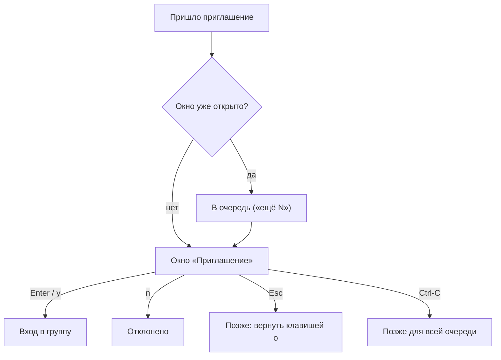

# Терминальный интерфейс (TUI)

TUI — основной способ работать с VoidLink из терминала: группы, друзья, участники и лог на одном экране, управление мышью и клавиатурой, командная строка `:` для всего остального. Документ описывает раскладку экрана, клавиши, попапы, экран настроек, темы и уведомления. Установка и запуск клиента описаны в [INSTALL.md](INSTALL.md), серверная часть — в [SERVER.md](SERVER.md), протокол приглашений и управления группами — в [PROTOCOL.md](PROTOCOL.md).

> **Статус.** Часть функций (экраны управления группой и серверами, индикаторы в статус-баре, раскладка ЙЦУКЕН для хоткеев, копирование через OSC 52) написана, но ещё подключается к интерфейсу. Такие места отмечены в тексте как **в доработке**.

## Содержание

- [Запуск](#запуск)
- [Главный экран](#главный-экран)
- [Навигация](#навигация)
- [Клавиши](#клавиши)
- [Мышь](#мышь)
- [Командная строка](#командная-строка)
- [Попапы](#попапы)
- [Экран настроек (F3)](#экран-настроек-f3)
- [Темы](#темы)
- [Уведомления и лог](#уведомления-и-лог)
- [Копирование в буфер обмена](#копирование-в-буфер-обмена)
- [Раскладка клавиатуры](#раскладка-клавиатуры)
- [Требования к терминалу](#требования-к-терминалу)
- [Советы](#советы)
- [В доработке](#в-доработке)

## Запуск

```bash
tunnel-client tui
```

То же делает `tunnel-client` без аргументов: `tui` — команда по умолчанию. Полные инструкции установки и команды для Windows (`tunnel-client.exe tui`) — в [INSTALL.md](INSTALL.md).

Если в конфиге ещё нет имени или сервера, `tui` сначала открывает экран первичной настройки: имя, сервер, адаптер и путь к dll. Позже всё это меняется в настройках (F3) или командой `:server`.

Выход — `Ctrl-C` (или `:quit`). Сессия завершается сразу, без подтверждения.

## Главный экран

```text
╭─ ◆ Tunnel ────────────────────────────────────────────────────────────────────╮
│ Максим · 203.0.113.10:7000 (main)                  ● подключено              │
╰──────────────────────────────────────────────────────────────────────────────╯
 F1 справка  F2 создать  j войти  x выйти  i пригласить  k исключить  a друг
╭─ ≡ Группы 2                ╮╭─ ◆ Группа 7 «Офис» (приватная)                 ╮
│ ▌● Офис [priv]   3/4       ││  имя        IP           связь     RTT         │
│  ● Гейминг       4/9       ││  Максим (я) 100.66.7.2   —         —           │
│  ○ Кафе (публ.)            ││  Анна       100.66.7.3   ◆ прямая   12 мс      │
│  ○ Старая сеть             ││  Лена       100.66.7.4   ◇ relay    48 мс      │
│                            ││  Дима       100.66.7.5   ○ офлайн              │
╰────────────────────────────╯│                                                │
╭─ ◇ Друзья 2/4              ╮│                                                │
│  ● Анна     общих 2        ││                                                │
│  ● Лена     общих 1        ││                                                │
│  ○ Игорь                   ││                                                │
│  ○ Дима                    ││                                                │
╰────────────────────────────╯╰─ сортировка: имя · s — сменить                 ╯
╭─ » Лог                                           ╮╭─ ↕ Трафик                ╮
│ 12:04:10 · подключено к 203.0.113.10:7000        ││ ↓ приём      3.2 КБ/с    │
│ 12:04:12 ✓ вход в группу «Офис»                  ││ ▁▂▃▂▁▂▄▅▃▂▁▂▃            │
│ 12:05:31 ! Анна: прямой путь потерян, relay      ││ ↑ передача   1.1 КБ/с    │
│                                                  ││ ▁▁▂▁▁▂▁▁▁▂▁              │
╰─ PgUp/PgDn или колесо                            ╯╰──────────────────────────╯
 IP 100.66.7.2   ◆ 1 direct  ◇ 2 relay   ≡ 2 групп   Группы Друзья Участники Лог
```

Экран делится на пять зон сверху вниз.

| Зона | Что показывает |
|------|----------------|
| Шапка (3 строки) | Ваше имя, статус, адрес и метка сервера, сообщение строки состояния (жёлтым). Справа — пилюля связи: **● подключено** или **○ реконнект**. |
| Панель действий (1 строка) | Кнопки с клавишами. Клик по кнопке равен нажатию клавиши. |
| Основная часть | Слева — **Группы** (сверху) и **Друзья** (снизу). Справа — **Участники** выбранной группы: имя, IP, связь (прямая или relay), RTT, статус. |
| Нижняя часть (8 строк) | Слева — **Лог**, справа — **Трафик** (если ширина терминала позволяет). |
| Строка статуса (1 строка) | Вкладки фокуса (клик переводит в панель), ваш IP в группе, счётчики прямых и relay-пиров, число ваших групп, активный фильтр `/…`. |

### Панели

- **Группы.** Значок `●` — группа, в которой вы состоите; `○` — группа, в которой вас нет. Счётчик `онлайн/всего` показан для ваших групп. Пометка `[priv]` — приватная группа; `(публичная)` и `(по приглашению)` — как в неё попасть.
- **Друзья.** `●` — друг в сети, `○` — не в сети. Справа указано число общих групп.
- **Участники.** Строка «я» всегда первая. Связь: `◆ прямая` — прямой туннель до участника, `◇ relay` — трафик идёт через сервер. Внизу панели — сортировка (клавиша `s`).
- **Лог.** Журнал событий с временем. Значки: `·` — информация, `✓` — успех, `!` — предупреждение, `✗` — ошибка.
- **Трафик.** Скорость приёма и передачи, график за последние секунды, пиковое значение и число пакетов. Появляется, только если ширина терминала не меньше 72 колонок. В узком окне скорость выводится в заголовке лога.

## Навигация

- `Tab` / `Shift-Tab` — переход между панелями по кругу: **Группы → Друзья → Участники → Лог**.
- `↑` / `↓` — перемещение по списку. `Home` / `End` — в начало и конец списка.
- `Enter` — действие над выбранным элементом: в группе — войти (если вы ещё не участник), у друга — открыть карточку. В остальных панелях ничего не делает.
- `/` — поиск (фильтр) по спискам. Ввод сразу сужает список; `Enter` принимает фильтр и выходит из строки поиска, `Esc` сбрасывает его. Пока фильтр активен, он виден в строке статуса.
- `s` — сменить сортировку участников: по имени → по онлайну → по RTT.
- `r` — обновить список групп.
- `Esc` вне попапа — сбросить фильтр и вернуть лог к последним записям.

## Клавиши

### Общие

| Клавиша | Действие |
|---------|----------|
| `F1`, `?` | Справка (окно с полным списком клавиш) |
| `:` | Командная строка (см. [ниже](#командная-строка)) |
| `F3` (или `F10`) | Настройки |
| `F2` | Создать группу |
| `Tab` / `Shift-Tab` | Смена панели |
| `↑` `↓` `Home` `End` | Перемещение по списку |
| `Enter` | Войти в группу / открыть карточку друга |
| `PgUp` / `PgDn` | Прокрутка лога на 5 строк |
| `/` | Поиск по спискам |
| `s` | Сортировка участников |
| `r` | Обновить список групп |
| `o` | Отложенные приглашения |
| `Ctrl-C` | Выход |

### Группы

| Клавиша | Действие |
|---------|----------|
| `F2` | Создать группу. В форме `Tab` переключает «приватная» |
| `F6` | Переименовать группу |
| `F8` | Удалить группу (только владелец, с подтверждением) |
| `j` | Войти в публичную группу |
| `x` | Покинуть группу (с подтверждением) |
| `i` | Пригласить друга в группу |
| `k` | Исключить участника из группы |
| `b` | Забанить участника в группе |

Для `i`, `k` и `b` открывается список (см. [Выбор участника](#выбор-участника)).

### Друзья и профиль

| Клавиша | Действие |
|---------|----------|
| `a` | Добавить друга по friend code |
| `d` | Удалить друга (с подтверждением) |
| `c` | Скопировать: в группах — IP группы, в участниках — IP участника, у друзей — публичный ключ (hex) |
| `p` | Карточка профиля (ваш friend code, имя, статус) |

В карточке профиля клавиша `c` копирует ваш friend code. В карточке друга `c` копирует friend code друга.

## Мышь

Мышь работает везде, где есть рамки и кнопки:

| Действие | Что происходит |
|----------|----------------|
| Клик по строке списка | Фокус на панель и выбор строки. Второй клик по той же строке равен `Enter`. |
| Клик по панели мимо строк | Только фокус на панель |
| Колесо над списком | Прокрутка списка под курсором |
| Колесо над логом | Прокрутка лога (по 3 строки) |
| Клик по кнопке панели действий | Нажатие соответствующей клавиши |
| Клик по кнопке в окне | То же, что клавиша этой кнопки |
| Клик по вкладке в строке статуса | Переход в панель |
| Клик мимо окна | Закрытие окна, как `Esc` |

Выделение текста мышью перехватывается программой. Чтобы выделить текст средствами терминала, зажмите `Shift` (в большинстве терминалов). Исключение — окно приглашения: клик мимо него не принимает приглашение, а откладывает его (см. [Приглашения](#приглашение-в-группу)).

## Командная строка

Нажмите `:`, введите команду без двоеточия и подтвердите `Enter`. Ошибки разбора показываются во всплывающем уведомлении. Команды `help`, `?` и пустая строка открывают справку.

### Группы

| Команда | Что делает |
|---------|------------|
| `:create <имя> [--private]` | Создать группу. С `--private` группа приватная |
| `:join <gid>` | Войти в группу |
| `:leave <gid>` | Покинуть группу |
| `:rename <gid> <новое имя>` | Переименовать группу |
| `:delete <gid>` | Удалить группу (владелец) |
| `:decline <gid>` | Отклонить приглашение в группу. Требует связи с сервером |
| `:invites` | Показать отложенные приглашения (то же, что `o`) |

### Участники

Участник в командах указывается одним из трёх способов: **friend code** (`TUN-…`), **hex-ключ** или **алиас** друга.

| Команда | Что делает |
|---------|------------|
| `:invite <gid> <участник>` | Пригласить в группу |
| `:kick <gid> <участник>` | Исключить из группы |
| `:ban <gid> <участник>` | Забанить в группе |
| `:unban <gid> <участник>` | Снять бан |
| `:transfer <gid> <участник>` | Передать владение группой. После передачи права владельца у вас пропадают |
| `:admin <gid>` (или `:bans <gid>`) | Запросить у сервера данные для управления группой (баны, приглашения). Экран — в [доработке](#в-доработке) |

### Друзья

| Команда | Что делает |
|---------|------------|
| `:friend <friend code> [алиас]` | Добавить друга. Без алиаса алиасом становится сам код |
| `:delfriend <алиас>` | Удалить друга по алиасу |
| `:copy ip` / `:copy code` | Скопировать IP выбранной группы или ваш friend code |

### Профиль и сервер

| Команда | Что делает |
|---------|------------|
| `:name <имя>` | Сменить ваше имя |
| `:status <текст>` | Сменить статус. Пустой текст очищает статус |
| `:invisible on` / `:invisible off` | Режим невидимки: другие видят вас офлайн |
| `:server <номер \| адрес \| метка>` | Переключиться на сервер из списка без перезапуска |
| `:sort name` / `:sort online` / `:sort rtt` | Сортировка участников |
| `:quit` (или `:q`) | Выход |

Пример:

```text
:create Офис --private
:invite 7 Anna
:friend TUN-XXXX-XXXX-XXXX Лена
:server 1
```

## Попапы

Попапы открываются поверх экрана. Пока открыт попап, клавиши относятся к нему. Закрывает попап `Esc` (кроме окна приглашения, где есть свои ответы), клик мимо окна тоже закрывает его.

### Справка (`F1`, `?`)

Полный список клавиш и мыши. Закрывается `Esc`, `Enter`, `F1` или кликом мимо окна. Другие клавиши не закрывают справку.

### Ввод (`F2`, `F6`, `a`, `:` и др.)

Однострочное поле с подсказкой внизу. `Enter` — отправить, `Esc` — отмена, `Backspace` — стереть символ. В форме создания группы `Tab` переключает признак «приватная».

### Подтверждение

Используется перед удалением группы или друга и перед выходом из группы. `y`, `Y` или `Enter` — подтвердить. Любая другая клавиша (например `Esc`) — отмена.

### Выбор участника

Открывается по `i`, `k`, `b` (и по нажатию на кнопки панели действий с этими клавишами).

- Для приглашения список — друзья и участники группы, дубликаты убраны. Последний пункт — **«ввести friend code вручную…»**, если нужного человека нет в списке.
- Для исключения и бана — участники группы.
- `↑` / `↓` — выбор, `Enter` — применить. Мышью: первый клик выбирает строку, второй по ней применяет.

### Карточка друга

Открывается по `Enter` на друге. Показывает алиас, friend code, список общих групп с видом (приватная или публичная). `c` — скопировать friend code, `Esc` — закрыть.

### Профиль (`p`)

Ваш identicon, имя, статус, friend code и служебные данные. `c` — скопировать friend code.

### Приглашение в группу

Окно появляется само, когда кто-то приглашает вас в группу. Показывает, от кого приглашение, название и gid группы и время получения.

| Клавиша / действие | Ответ |
|--------------------|-------|
| `Enter` или `y` | Принять: вход в группу |
| `n` (или `т` в русской раскладке) | Отклонить |
| `Esc` (или `l`, `д`) | Позже: окно закрыто, приглашение остаётся на сервере |
| `Ctrl-C` | Позже для всего, что в очереди |
| `o` (на главном экране) | Вернуть отложенные приглашения |



Защита от случайного нажатия: первые 0,4 секунды после появления окна `Enter`, `y`, `n` и клики не отвечают — они могли предназначаться основному экрану. `Esc` работает сразу.

Приглашение, которое вы отклонили, не появляется снова в течение 5 секунд. Приглашение снимается автоматически, если вы вошли в группу или её удалили, а также если список приглашений с сервера его больше не содержит.

Приглашения от друзей показывают алиас друга, а не только публичный ключ.

## Экран настроек (F3)

Окно «Настройки» с пятью строками. Выбор — `↑` / `↓` (или колесо), изменение — `Enter` или клик. `Esc` закрывает окно.

| Строка | Что изменяется | Как |
|--------|----------------|-----|
| **имя** | Имя профиля, которое видят другие | Однострочное поле, `Enter` — сохранить |
| **статус** | Короткий текст статуса | Однострочное поле, `Enter` — сохранить |
| **сервер** | Сервер, с которым клиент работает | Список серверов из конфига. Выбранный сервер становится первым в конфиге и применится **после перезапуска** |
| **автовход** | Группы, в которые клиент входит при старте | Список ваших групп с галочками. `Enter` переключает галочку, окно остаётся открытым |
| **тема** | Цветовая схема | `Enter` переключает тему по кругу и сразу сохраняет выбор |

Для переключения сервера без перезапуска используйте команду `:server` (см. [выше](#профиль-и-сервер)).

## Темы

Тема переключается в настройках (строка «тема») и сохраняется в конфиге клиента. Порядок переключения: тёмная → светлая → контрастная → янтарная → фьорд → тёмная.

| Тема (ключ) | Для чего | Описание |
|-------------|----------|----------|
| **тёмная** (`dark`) | Работа в обычной обстановке, тема по умолчанию | Глубокий сине-серый фон, один акцент — небесно-голубой |
| **светлая** (`light`) | Яркое освещение, дневная работа, светлый фон терминала | Тёмный текст на почти белом фоне, насыщенные тёмные цвета для статусов |
| **контрастная** (`contrast`) | Когда важна максимальная разборчивость текста: яркий свет, слабое зрение | Чёрный фон, белый текст, яркие циан и жёлтый. Текст задуман не ниже 7:1 по контрасту |
| **янтарная** (`amber`) | Тёплая палитра для тех, кто предпочитает тёплые оттенки и мягкий свет | Тёмно-коричневый фон, медовый акцент |
| **фьорд** (`fjord`) | Спокойная холодная палитра | Серо-синий сумрак, ледяной циан |

Тема сама красит фон кадра, поэтому светлая тема выглядит одинаково независимо от фона вашего терминала.

## Уведомления и лог

### Тосты

Короткие сообщения в правом нижнем углу над строкой статуса. Исчезают через 5 секунд. Видно не больше пяти последних. Значки:

| Значок | Тип | Цвет рамки |
|--------|-----|-----------|
| `•` | Информация | Акцентный |
| `✓` | Успех | Зелёный |
| `!` | Предупреждение | Жёлтый |
| `✗` | Ошибка | Красный |

Тосты обычно не дублируются в лог: лог — журнал событий, тосты — подтверждения действий и ошибки команд.

### Лог

Панель «Лог» хранит последние 400 записей с временем. Прокрутка — `PgUp` / `PgDn` или колесо мыши. Чтобы вернуться к последним записям, нажмите `Esc` на главном экране.

## Копирование в буфер обмена

Клавиши копирования: `c` в группах, участниках и друзьях, а также `c` в карточках профиля и друга. Команда `:copy ip` и `:copy code` делает то же самое.

В текущей сборке копирование использует системную утилиту: `clip` на Windows и `pbcopy` на macOS. Текст, который попал в буфер, подтверждается тостом с самим текстом.

- **Linux.** Системный буфер пока не заполняется: `pbcopy` там отсутствует. Тост при этом всё равно появляется, поэтому если вставить не удалось, проверьте текст вручную.
- **Через SSH.** Копирование через OSC 52 (буфер того терминала, где вы сидите) — **в доработке**. Пока копирование в удалённой сессии работает только если на удалённой машине есть утилита, которую клиент умеет вызывать.

## Раскладка клавиатуры

Хоткеи TUI написаны для латиницы (QWERTY): `q`, `j`, `k`, `i`, `s` и т. д. В текущей сборке при включённой русской раскладке (ЙЦУКЕН) они **не работают**: модуль `keymap` (перевод кириллицы в клавиши QWERTY на той же позиции) написан, но ещё не подключён к обработке клавиш. Поля ввода текста принимают любые символы, включая кириллицу.

Исключения — окно приглашения и окно управления группой (в доработке): там уже учитываются русские буквы, например `т` вместо `n`, `д` вместо `l`, `н` вместо `y`.

Клавиши `F1`–`F10`, `Tab`, `Enter`, `Esc`, стрелки и `Ctrl-C` работают в любой раскладке. Для работы на русской раскладке используйте их или переключитесь на латиницу.

## Требования к терминалу

- Рекомендуется **80 × 24** символов и больше. Вся разметка занимает 21 строку по высоте: шапка, панель действий, основная часть (от 8 строк), нижняя часть (8 строк) и строка статуса. При меньшей высоте часть панелей не поместится.
- Панель «Трафик» появляется при ширине от 72 колонок.
- Нужен UTF-8 и поддержка 24-битного цвета: темы заданы RGB-палитрами. Для символов `◆ ● ◇ ▁▂▃` нужен шрифт, в котором они есть.
- Мышь использует стандартные escape-последовательности xterm, их поддерживают большинство современных терминалов.

## Советы

- Начинайте с `Tab`: он переводит фокус по панелям, а `Enter` тогда действует именно там, где вы стоите.
- Если хоткей не реагирует, проверьте раскладку (см. [выше](#раскладка-клавиатуры)) и открыт ли попап: клавиши сначала уходят в него.
- Команды `:` удобнее клавиш, когда нужен точный gid или алиас. Всё, что доступно клавишами, есть и в командах.
- Кнопки в панели действий — хороший способ запомнить клавиши: подпись на кнопке показывает клавишу.
- Фильтр `/` работает и в группах, и в друзьях. Строка статуса показывает активный фильтр, чтобы вы не потеряли список.
- Сообщение о последнем действии выводится жёлтым цветом в шапке. Если что-то «не происходит», посмотрите и его, и лог, и тосты.

## В доработке

Эти части описаны по текущему плану и могут измениться до выпуска.

- **Экран управления группой** (владелец): баны, отложенные приглашения и передача владения в одном окне с вкладками. Вход — команда `:admin <gid>` и (планируется) клавиша `m` на своей группе. В окне: `Tab` и `1`–`3` переключают вкладки, `Enter` — действие над строкой, `Delete` — удалить запись, передача владения требует отдельного подтверждения `y`.
- **Экран серверов**: список серверов профиля с переключением без перезапуска, добавлением и удалением, правка адаптера и пути к `wintun.dll`. Вход — `F4`, команда `:servers` или строка «сервер» в настройках.
- **Индикаторы в строке статуса**: счётчик приглашений (`✉ N`, кликабельный — открывает отложенные), индикатор соединения, метка режима невидимки, транспорт UDP/TCP, счётчики прямых и relay-пиров.
- **Раскладка ЙЦУКЕН** для всех хоткеев.
- **Копирование через OSC 52** при работе по SSH и через `wl-copy` / `xclip` / `xsel` на Linux.
- **Переименование друзей**: клавиша `r` в списке друзей и команда `:alias <друг> <имя>`.
- **Режим невидимки** переключается в настройках, а не только командой.
- **Срок действия приглашения** в окне («истекает через N дн.»).
- **Уведомления** о разрыве прямого пути, смене ключа сервера и исключении из группы.
- **Местное время** в логе вместо времени с запуска программы.

Если какая-то клавиша из этого раздела не работает в вашей сборке, сообщите в трекере или проверьте [PLAN.md](PLAN.md).
